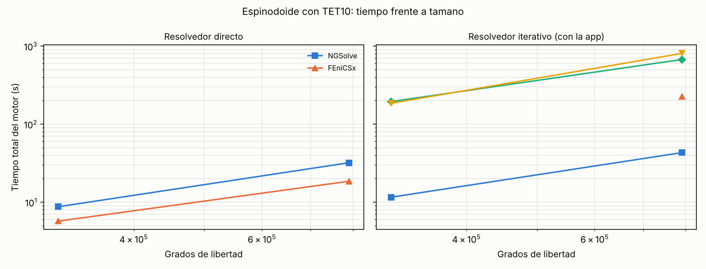
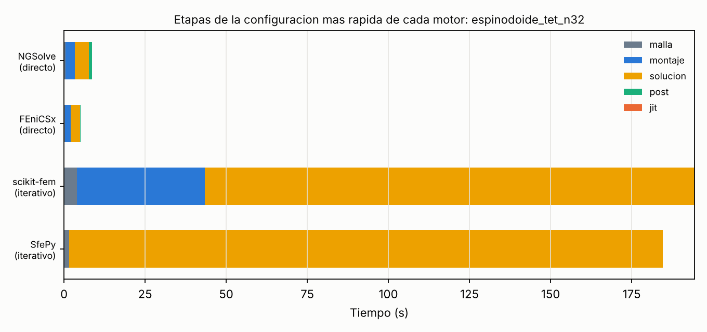

# Tiempos de cómputo y protocolo de Tapia et al. (2026) en los cinco motores de elementos finitos de spinpy

Fecha: 2026-10-12. spinpy V2.1.1. Este documento reúne el trabajo de la sesión: la medición del tiempo de ejecución de todos los motores (parte I) y la réplica del protocolo de Tapia et al. con cada motor sobre muestras porcinas y sus estructuras generadas (parte II). Código, datos y figuras: `comparativa_motores/tiempos_sesion/` y `comparativa_motores/tapia/`.

## Resumen general

**Tiempos.** Con malla de hexaedros (365 655 GDL), los resolvedores directos de NGSolve y FEniCSx tardaron 9,2 y 9,9 s, frente a 47,5 s de la app y 130 s de scikit-fem. Con TET10 (790 599 GDL), FEniCSx resolvió en 18,5 s, NGSolve en 32,0 s, scikit-fem en 673 s y SfePy en 806 s. En el espinodoide no lineal a 24³, FEniCSx tardó 3,2 s, NGSolve 6,3 s y scikit-fem 110 s; SfePy no convergió. Los tiempos fueron una mediana de 0,73 veces los de la campaña publicada, con la misma ordenación entre motores.

**Protocolo de Tapia.** En dos VOI porcinos y en sus spinodoides y dual-lattices ajustados (seis estructuras), los cinco motores dieron el mismo módulo aparente, el mismo p99 y máximo de von Mises y el mismo desplazamiento máximo. Elemento a elemento, la mayor diferencia de von Mises frente a NGSolve (directo) fue de 10⁻⁹ del p99 con la app, de 10⁻¹¹ a 10⁻¹⁰ con scikit-fem y SfePy, de 10⁻¹¹ con FEniCSx y de 10⁻¹³ con NGSolve, un orden que coincide con las tolerancias de los resolvedores. La variación entre estructuras superó en varios órdenes de magnitud a la variación entre motores.

**Conclusión.** La elección del motor puede hacerse por tiempo, memoria y facilidad de distribución, y no por el resultado mecánico, siempre que los resolvedores estén convergidos y la malla sea la misma.

## Parte I. Tiempos de ejecución de los motores


Fecha: 2026-10-12. spinpy V2.1.1. Banco de pruebas: `comparativa_motores/correr.py` (opción `--salida`). Datos: `comparativa_motores/tiempos_sesion/*.jsonl`. Tablas completas: `tablas_tiempos.md`. Figuras: `t_escala_hex.png`, `t_escala_tet.png`, `t_etapas_hex64.png`, `t_etapas_tet32.png`. Generador: `comparativa_motores/informe_tiempos.py`.

### Resumen

**Objetivo.** Medir cuánto tarda cada motor de elementos finitos integrado en spinpy (la app, NGSolve, FEniCSx, scikit-fem y SfePy) en los mismos problemas discretos de la comparativa publicada en `comparativa_motores/INFORME.md`, y contrastar la ordenación con esa campaña.

**Métodos.** Se repitió la campaña completa (95 corridas) con las mismas mallas y resolvedores: bloque macizo, cavidad esférica, espinodoide con hexaedros (24³ a 80³, de 30 672 a 661 965 grados de libertad, GDL), espinodoide con TET10 (314 880 y 790 599 GDL) y problemas no lineales con St. Venant-Kirchhoff y neo-Hookeano. Cada corrida se ejecutó en un proceso hijo, con 4 hilos y de forma secuencial, y se registró el tiempo de reloj de pared por etapas y la memoria residente de pico.

**Resultados.** Con malla de hexaedros, los resolvedores directos de NGSolve y FEniCSx fueron los más rápidos (9,2 y 9,9 s a 365 655 GDL, frente a 47,5 s de la app y 130 s de scikit-fem con su resolvedor iterativo). Con TET10 a 790 599 GDL, FEniCSx con MUMPS resolvió en 18,5 s y NGSolve con Cholesky propio en 32,0 s, mientras que scikit-fem y SfePy necesitaron 673 y 806 s. En el espinodoide no lineal a 24³, FEniCSx tardó 3,2 s (St. Venant-Kirchhoff), NGSolve 6,3 s y scikit-fem 110 s; SfePy no convergió. Respecto de la campaña publicada, los tiempos de esta sesión fueron menores (mediana del cociente 0,73; percentiles 10 y 90 de 0,62 y 0,80, n = 46 pares), y la ordenación entre motores se mantuvo salvo en un punto: con hexaedros, el directo de NGSolve y el de FEniCSx quedaron prácticamente empatados.

**Conclusión.** La ordenación de motores por tiempo es estable entre campañas y equipos del mismo tipo; las cifras absolutas no lo son. Para malla de hexaedros lineal, el resolvedor propio de la app es competitivo con los iterativos de las bibliotecas, pero queda por detrás de cualquier factorización directa multihilo mientras esta quepa en memoria.

### 1. Diseño

#### 1.1 Equipo y versiones

Equipo: Intel Xeon a 2,10 GHz, 4 CPU virtuales, 15 GB de memoria, Linux 6.18, Python 3.13 (FEniCSx con el Python 3.x de su entorno de conda-forge). Versiones: spinpy 2.1.1, NGSolve 6.2.2608, scikit-fem 12.0.2, SfePy 2026.3, FEniCSx 0.11.0, numpy 2.5.3, scipy 1.18.1, pyamg 5.3.0. La configuración de hilos fue `OMP_NUM_THREADS = MKL_NUM_THREADS = OPENBLAS_NUM_THREADS = 4`.

#### 1.2 Problemas

Son los casos de `comparativa_motores/casos.py`, sin modificaciones, descritos en la sección 2.2 del informe de motores: bloque macizo (hexaedros y TET10), cavidad esférica (hexaedros a 32³ y TET10), espinodoide con hexaedros a 24³, 32³, 48³, 64³ y 80³, espinodoide con TET10 a 32³ y 48³, y espinodoide no lineal a 24³ con plato rígido hasta el 2 % de deformación. Todos los motores reciben el mismo problema discreto (`spinpy.motores.problema_de_malla`).

#### 1.3 Medida

El tiempo informado es el `tiempo_total_s` de cada motor: malla propia del motor, compilación JIT, montaje, resolución y extracción de resultados. No incluye la importación de la biblioteca ni la construcción de la malla de spinpy, que es común a todos. La memoria es el pico residente (`VmHWM`) del proceso hijo. Un vigilante detenía cada corrida por encima de 13 GB o de una hora. Cada combinación de caso, motor y resolvedor se ejecutó **una sola vez**.

Resolvedores comparados: la app usa su CG con multigrid algebraico (pyamg) y modos rígidos. Los demás motores se ejecutaron con un resolvedor directo (NGSolve: Cholesky propio; FEniCSx: MUMPS; scikit-fem y SfePy: SuperLU) y con uno iterativo (CG con multigrid algebraico o BDDC). Los directos de scikit-fem y SfePy solo se ejecutaron hasta 1,5·10⁵ GDL, y el directo de los demás hasta 4·10⁵ GDL con hexaedros y 1,2·10⁶ con TET10, que son los límites del banco de pruebas.

### 2. Resultados

#### 2.1 Espinodoide con hexaedros

Tiempo total del motor en segundos. `n/d`: no ejecutado por el límite de GDL del resolvedor directo.

| Malla | GDL | App | NGSolve dir. | NGSolve ite. | FEniCSx dir. | FEniCSx ite. | scikit-fem dir. | scikit-fem ite. | SfePy dir. | SfePy ite. |
|---|---:|---:|---:|---:|---:|---:|---:|---:|---:|---:|
| 24³ | 30 672 | 2,40 | 0,69 | 3,78 | 1,13 | 2,49 | 4,97 | 5,91 | 4,04 | 3,10 |
| 32³ | 62 595 | 5,33 | 1,01 | 6,61 | 1,72 | 5,20 | 11,3 | 12,5 | 10,0 | 6,68 |
| 48³ | 173 484 | 24,9 | 3,80 | 32,0 | 4,35 | 21,4 | n/d | 61,9 | n/d | 32,5 |
| 64³ | 365 655 | 47,5 | 9,21 | 50,9 | 9,91 | 43,3 | n/d | 130,0 | n/d | 55,1 |
| 80³ | 661 965 | 102,3 | n/d | 107,3 | n/d | 78,9 | n/d | 291,9 | n/d | 115,6 |


Con los resolvedores iterativos, NGSolve, FEniCSx y SfePy tardaron entre 0,8 y 1,6 veces lo que la app, y scikit-fem entre 2,3 y 2,9 veces, y el exponente de escala frente a los GDL estuvo entre 1,1 y 1,3 en todos. Con resolvedor directo, a 365 655 GDL NGSolve y FEniCSx tardaron la quinta parte que la app. El exponente del directo de NGSolve fue 1,09 (4 puntos) y el de FEniCSx 0,88 (4 puntos); con tan pocos puntos y con un coste fijo que domina en los tamaños pequeños, estos exponentes no deben leerse como una ley asintótica.

Memoria de pico a 365 655 GDL: app 1,4 GB; NGSolve 1,5 GB (directo); FEniCSx 1,7 GB (directo); SfePy 1,5 GB (iterativo); scikit-fem 3,0 GB (iterativo).

#### 2.2 Espinodoide con TET10

| Malla | GDL | NGSolve dir. | NGSolve ite. | FEniCSx dir. | FEniCSx ite. | scikit-fem ite. | SfePy ite. |
|---|---:|---:|---:|---:|---:|---:|---:|
| 32³ | 314 880 | 8,73 | 11,6 | 5,71 | fallo | 194,4 | 184,9 |
| 48³ | 790 599 | 32,0 | 43,1 | 18,5 | 225,0 | 672,7 | 806,1 |



La app no resuelve TET10. Con 790 599 GDL, el directo de FEniCSx fue 1,7 veces más rápido que el de NGSolve y 36 veces más rápido que el iterativo de scikit-fem (673 s), con una memoria de pico de 3,6 GB frente a 3,2 GB de NGSolve y 6,8 GB de scikit-fem. El iterativo de FEniCSx (CG con GAMG) no convergió en la malla de 314 880 GDL (PETSc KSP, motivo -8) y necesitó 225 s en la de 790 599 GDL, lo cual es coherente con la divergencia descrita en el informe de motores.



La figura de etapas muestra que, en scikit-fem, el montaje (unos 40 s) pesa tanto como el 20 % del total, y que en los motores iterativos la resolución domina el tiempo (más del 75 %).

#### 2.3 Problemas pequeños y cavidad esférica

| Caso | GDL | App | NGSolve dir. | NGSolve ite. | FEniCSx dir. | FEniCSx ite. | scikit-fem dir. | scikit-fem ite. | SfePy dir. | SfePy ite. |
|---|---:|---:|---:|---:|---:|---:|---:|---:|---:|---:|
| bloque (hex) | 3 159 | 0,20 | 0,32 | 0,33 | 0,72 | 0,74 | 0,89 | 0,90 | 0,89 | 0,91 |
| bloque (TET10) | 13 446 | n/d | 0,42 | 0,51 | 0,85 | 1,36 | 1,84 | 1,93 | 2,91 | 1,71 |
| cavidad (hex 32³) | 105 558 | 7,59 | 26,7 | 5,97 | 5,17 | 6,32 | 316,8 | 28,2 | 591,2 | 7,71 |
| cavidad (TET10) | 206 142 | n/d | 27,4 | 31,7 | 7,80 | 26,0 | n/d | 46,3 | n/d | 35,8 |

En los problemas de unos pocos miles de GDL, la app fue el motor más rápido (0,20 s), porque el resto paga un coste fijo de arranque (montaje de formas, compilación JIT en FEniCSx). En la cavidad con hexaedros, el directo de NGSolve (26,7 s) fue más lento que su propio iterativo (5,97 s), y los directos SuperLU de scikit-fem y SfePy (317 y 591 s) fueron entre 11 y 77 veces más lentos que los iterativos de esos motores, un efecto del relleno de SuperLU en 3D sin ordenación de disección anidada.

#### 2.4 Problemas no lineales

Newton con resolvedor directo, plato rígido. Tiempo total en segundos.

| Caso | GDL | NGSolve | FEniCSx | scikit-fem | SfePy |
|---|---:|---:|---:|---:|---:|
| bloque, St. Venant-Kirchhoff | 525 | 0,31 | 2,81 | 2,42 | 1,77 |
| bloque, neo-Hookeano | 525 | 0,33 | 2,51 | 4,72 | n/d |
| espinodoide 24³, St. Venant-Kirchhoff | 30 672 | 6,26 | 3,23 | 110,4 | fallo |
| espinodoide 24³, neo-Hookeano | 30 672 | 7,57 | 3,78 | 175,0 | n/d |

En el bloque de 525 GDL, el tiempo de FEniCSx está dominado por la compilación JIT de las formas (1,8 a 2,1 s de 2,5 a 2,8 s totales); esa compilación solo ocurre la primera vez que se usa cada forma, y después queda en caché en disco. Con 30 672 GDL, FEniCSx fue el más rápido (3,2 y 3,8 s) y scikit-fem el más lento (110 y 175 s), 34 y 46 veces más que FEniCSx. El Newton de SfePy no convergió en el espinodoide a la carga del 2 % (30 iteraciones), y en el bloque necesitó entre 22 y 27 iteraciones por paso de carga frente a 3 de los demás motores, lo que confirma que su tangente no es consistente con el residuo.

#### 2.5 Reproducibilidad frente a la campaña publicada

En los 46 pares de corridas del espinodoide (hexaedros y TET10) que existen en ambas campañas, el tiempo de esta sesión fue menor que el publicado, con una mediana del cociente de 0,73 (percentiles 10 y 90: 0,62 y 0,80). El cociente más bajo (0,44 a 0,49) correspondió al directo de NGSolve, y es esperable: la versión publicada usaba PARDISO (MKL) como directo por omisión, mientras que NGSolve instalado desde PyPI ya no incluye MKL y esta sesión usó su Cholesky propio. No se midió la causa del resto de la diferencia (otro procesador, otras versiones de las bibliotecas). Dado que se trata de una única corrida por combinación, no se estimó la variabilidad entre repeticiones.

### 3. Discusión

La comparación de tiempos depende más del resolvedor que del motor. Con el mismo tipo de resolvedor, las diferencias entre NGSolve, FEniCSx y SfePy son modestas (entre 0,8 y 1,6 veces el tiempo de la app en los iterativos con hexaedros); las diferencias grandes aparecen entre factorizaciones directas multihilo (NGSolve, FEniCSx) y los resolvedores secuenciales de SciPy (SuperLU en scikit-fem y SfePy), y con TET10 también entre el iterativo de SfePy y scikit-fem (un orden de magnitud más lentos) y los directos de NGSolve y FEniCSx. La ventaja práctica de los directos tiene como contrapartida la memoria, que crece más deprisa que el tiempo, de modo que con la malla de hexaedros a 80³ el banco de pruebas no ejecutó el directo.

Para la aplicación, estos datos respaldan lo ya recomendado en el informe de motores: NGSolve para TET10 y no lineal (instalable con pip en Windows, 32 s a 790 599 GDL), y el resolvedor propio para hexaedros lineales. FEniCSx fue más rápido que NGSolve en TET10 y en el no lineal de tamaño medio, pero requiere conda y un compilador de C en tiempo de ejecución, lo que limita su distribución.

### 4. Limitaciones

- Una sola corrida por combinación y un solo equipo: no se estimó la variabilidad entre repeticiones ni entre máquinas. Las diferencias menores de aproximadamente 20 % entre motores no deben interpretarse como ordenación firme.
- El tiempo de NGSolve con el directo corresponde a su Cholesky propio, no a PARDISO. La comparación con la campaña publicada mezcla, por tanto, dos resolvedores directos distintos para este motor.
- Durante la corrida de SfePy con SuperLU en la cavidad de hexaedros (591 s) se ejecutó en paralelo, durante unos 5 minutos, una prueba corta de la réplica del protocolo de Tapia (la app y NGSolve sobre un VOI de 40³). Esa medición puede estar algo inflada y no cambia la conclusión (SuperLU quedó entre 11 y 77 veces por detrás de los iterativos).
- No se ejecutaron los directos de scikit-fem y SfePy por encima de 1,5·10⁵ GDL, ni los de NGSolve y FEniCSx con hexaedros a 80³ (límite de 4·10⁵ GDL del banco de pruebas), por lo que no hay comparación en esas celdas.
- El tiempo no incluye la importación de las bibliotecas ni el mallado de spinpy. En FEniCSx, la compilación JIT de la primera ejecución se informa aparte y no se repitió.
- Esta es una medición computacional y no un estudio observacional ni clínico; no existe una guía de reporte (STROBE, CONSORT, PRISMA, etc.) que le sea aplicable, por lo que no se incluye lista de chequeo.

### 5. Reproducir

```
pip install scipy scikit-image pyamg scikit-fem ngsolve sfepy tetgen pymeshfix pyvista pandas joblib matplotlib
# FEniCSx (conda-forge): fenics-dolfinx, numpy, scipy, petsc4py, mpich, y los paquetes anteriores
export FENICSX_PYTHON=/ruta/al/entorno/fx/bin/python
cd comparativa_motores
python correr.py exactos cavidad nl espinodoide_hex espinodoide_tet --salida tiempos_sesion
python informe_tiempos.py
```


## Parte II. Protocolo de Tapia et al. (2026) en cada motor

Fecha: 2026-10-12. spinpy V2.1.1. Código: `comparativa_motores/tapia/` (`ajustar.py`, `replicar_tapia.py`, `figuras_tapia.py`). Datos: `resultados/tapia.jsonl` (una fila por corrida), `campos/*.npz` (campos por elemento y desplazamientos nodales), `estructuras/` (parámetros, error y huella de cada estructura generada). Tablas completas: `tablas_tapia.md`.

### Resumen

**Objetivo.** Aplicar el análisis de compresión del protocolo de Tapia et al. (2026) a muestras porcinas reales y a sus estructuras generadas, resolverlo con cada motor de elementos finitos de spinpy y cuantificar cuánto difieren entre sí los campos de tensión de von Mises y de deformación total.

**Métodos.** Se seleccionaron dos volúmenes de interés (VOI) porcinos de micro-TC, C2 y C4 (188³ vóxeles a 16 µm; BV/TV 0,388 y 0,333), que cubren el rango de los cuatro disponibles. A cada uno se le ajustó un spinodoide y un dual-lattice con el procedimiento del informe automático de la app (modo completo, resolución de comparación de 96³, semilla 20260720). Las seis estructuras (2 VOI, 2 spinodoides, 2 dual-lattices) se mallaron con hexaedros de vóxel a 40³ y se ensayaron con el protocolo de Tapia implementado en `fem.PROTOCOLOS_FEM["tapia2026"]` (base empotrada, E_s = 18 GPa, ν = 0,30, 100 N axiales sobre la sección bruta, material lineal elástico) con la app, NGSolve, FEniCSx, scikit-fem y SfePy. NGSolve con factorización directa se ejecutó además por separado como referencia. Las diferencias se calcularon por elemento como |motor − referencia| dividido por el percentil 99 del campo de referencia en el tejido.

**Resultados.** Los cinco motores dieron el mismo módulo aparente, el mismo p99 y el mismo máximo de von Mises, y el mismo desplazamiento máximo, en las seis estructuras, con las cifras mostradas en las tablas. Elemento a elemento, la mayor diferencia de von Mises frente a la referencia fue de 3,7·10⁻⁹ a 9,1·10⁻⁹ del p99 con la app, de 3,7·10⁻¹¹ a 1,4·10⁻¹⁰ con scikit-fem y SfePy, de 2,8·10⁻¹² a 2,2·10⁻¹¹ con FEniCSx y de 4,3·10⁻¹⁴ a 1,5·10⁻¹³ con NGSolve; en deformación total fueron de magnitud similar. El orden de las diferencias reproduce el orden de las tolerancias de los resolvedores (app 10⁻⁸, scikit-fem y SfePy 10⁻¹⁰, directos 10⁻¹² o menos). Entre estructuras, los dual-lattices tuvieron un módulo aparente un 20 % menor que el de su VOI (C2: 2571 frente a 3220 MPa; C4: 2393 frente a 3018 MPa) y los spinodoides entre un 58 % y un 72 % menor (1361 y 858 MPa).

**Conclusión.** Con una malla común y resolvedores convergidos, la elección del motor no modifica los mapas de tensión ni de desplazamiento del protocolo de Tapia a ningún nivel visible, y las diferencias numéricas son del orden de la tolerancia de cada resolvedor. La variación entre estructuras es de varios órdenes de magnitud mayor que la variación entre motores.

### 1. Alcance y diferencias con el estudio original

Lo que se replica es el **protocolo de ensayo** (condiciones de contorno, carga y constantes del material) y el tipo de salida (von Mises y deformación total), no el estudio original. Tapia et al. analizaron vértebras de dos cérvidos sudamericanos, y el mallado original fue de tetraedros SOLID187 de 0,05 mm en ANSYS (`fem.PROTOCOLOS_FEM`, campo `tam_elem_mm`). Aquí las muestras son VOI porcinos y las mallas son hexaedros de un vóxel a 40³ (lado de 3,008 mm, 0,075 mm por elemento), la resolución por omisión de la app. Por tanto, los valores absolutos de tensión y rigidez de este informe no son comparables con los publicados por Tapia et al.; sí lo son entre motores, que es lo que se midió.

La elasticidad es lineal, sin plasticidad ni daño. En el protocolo, 100 N sobre 9,05 mm² equivalen a 11,05 MPa de tensión aparente, y en el spinodoide de C4 el máximo de von Mises llegó a 483 MPa (874 MPa en el de C2); el comportamiento no lineal a esa carga no se evaluó aquí.

### 2. Métodos

#### 2.1 Muestras

| VOI | Forma | Vóxel (µm) | BV/TV |
|---|---|---:|---:|
| C2 | 188³ | 16 | 0,388 |
| C4 | 188³ | 16 | 0,333 |

C2 y C4 son el más denso y el menos denso de los cuatro VOIs recibidos (C1 a C4; BV/TV 0,365, 0,388, 0,335 y 0,333 respectivamente), de modo que cubren el rango disponible. C1 y C3 no se analizaron.

#### 2.2 Estructuras generadas

Se ajustaron con `ajustar_spinodoide` y `ajustar_dual_lattice` (modo completo, sin término mecánico ni réplicas de incertidumbre, resolución de comparación de 96³, semilla 20260720) y se regeneraron desde sus parámetros con la misma traducción que usa la app (`informe._regenerar`). Cada máscara se guardó con su huella SHA-256.

| VOI | Familia | Error del ajuste | BV/TV generado | BV/TV del VOI | Parámetros principales |
|---|---|---:|---:|---:|---|
| C2 | Spinodoide | 0,00175 | 0,386 | 0,388 | número de onda 15π, 700 ondas, θ = (45°, 60°, 15°) |
| C2 | Dual-lattice | 0,00057 | 0,388 | 0,388 | 4,24 celdas, estiramiento (1,0, 2,0, 1,0) |
| C4 | Spinodoide | 0,00148 | 0,324 | 0,333 | número de onda 18π, 700 ondas, θ = (15°, 45°, 15°) |
| C4 | Dual-lattice | 0,00064 | 0,333 | 0,333 | 5,0 celdas, estiramiento (1,5, 1,0, 2,5) |

Cada familia se ajustó una sola vez por VOI y no se evaluó la incertidumbre del ajuste.

#### 2.3 Ensayo

Se remuestreó cada máscara a 40³ por vecino más próximo, como hace la app, se mallaron los hexaedros con `fem.mallar` (de 20 559 a 24 790 elementos y de 134 322 a 142 176 GDL según la estructura) y se aplicó el protocolo de Tapia. Cada motor resolvió el mismo problema discreto en un proceso hijo con su resolvedor automático, que es lo que obtiene el usuario en la app:

| Motor | Versión | Resolvedor automático a este tamaño |
|---|---|---|
| App (spinpy) | 2.1.1 | CG con multigrid algebraico (pyamg), tolerancia ≈ 10⁻⁸ |
| NGSolve | 6.2.2608 | Cholesky propio (sparsecholesky) |
| FEniCSx | 0.11.0 | Cholesky de MUMPS (PETSc) |
| scikit-fem | 12.0.2 | CG + multigrid algebraico (pyamg), tolerancia 10⁻¹⁰ |
| SfePy | 2026.3 | CG + pyamg, tolerancia 10⁻¹⁰ |

La referencia es NGSolve con el resolvedor directo. **NGSolve con resolvedor automático y la referencia usan el mismo algoritmo** (en este tamaño el automático elige el mismo Cholesky), de modo que su diferencia mide solo el redondeo y la repetibilidad, no una discrepancia entre motores independientes. Las diferencias de los otros cuatro motores sí lo son.

#### 2.4 Campos comparados

- **Tensión de von Mises por elemento** (MPa), a partir de la tensión media del elemento (`fem.tension_elemental`, convención de la app para hexaedros).
- **Deformación total por elemento** (mm): módulo del desplazamiento |u| promediado en los 8 nodos de cada elemento, la variable `campo_desp` de la app.
- **Diferencia relativa**: |motor − referencia| / p99 de la referencia, por elemento; en los mapas se muestra su logaritmo decimal, truncado por debajo de 10⁻¹⁴.

### 3. Resultados

#### 3.1 Respuesta mecánica por estructura

Valores idénticos en los cinco motores (referencia de NGSolve).

| VOI | Estructura | E_app (MPa) | p99 von Mises (MPa) | Máx. von Mises (MPa) | ‖u‖ máx. (mm) |
|---|---|---:|---:|---:|---:|
| C2 | VOI | 3219,6 | 91,2 | 203,1 | 0,0272 |
| C2 | Spinodoide | 1361,4 | 162,6 | 874,7 | 0,1214 |
| C2 | Dual-lattice | 2571,0 | 109,1 | 509,9 | 0,1453 |
| C4 | VOI | 3017,6 | 94,6 | 275,4 | 0,0408 |
| C4 | Spinodoide | 857,6 | 231,9 | 482,9 | 0,1260 |
| C4 | Dual-lattice | 2392,6 | 117,3 | 270,8 | 0,0323 |

Respecto de su VOI, el dual-lattice tuvo un módulo aparente un 20 % menor en C2 y un 21 % menor en C4, y un p99 de von Mises un 20 % y un 24 % mayor. El spinodoide tuvo un módulo un 58 % menor en C2 y un 72 % menor en C4, y un p99 un 78 % y un 145 % mayor. Estas comparaciones corresponden a un único ajuste por VOI y a una única semilla, y no permiten generalizar el comportamiento de cada familia.

#### 3.2 Mapas por motor


A simple vista, los cinco mapas de cada fila son indistinguibles, tanto en von Mises como en deformación total. En las seis estructuras, la concentración de tensión y de desplazamiento se sitúa en las trabéculas de la mitad superior del cubo, que es donde se aplica la carga con base empotrada, y el desplazamiento decrece hacia la base. La escala de color es una por fila (percentiles 1 a 99 de la referencia).

#### 3.3 Diferencias entre motores


Los mapas de diferencia están en escala logarítmica entre 10⁻¹⁴ y 10⁻⁷ del p99. No muestran estructura espacial coherente en ningún motor: el patrón es de ruido de redondeo distribuido por todo el tejido, con un nivel de color uniforme por motor. La app es la que más difiere (del orden de 10⁻¹⁰ del p99 en la mediana de los elementos), seguida de scikit-fem y SfePy, que son prácticamente idénticos entre sí, FEniCSx y NGSolve.


Máxima diferencia por elemento en las seis estructuras (rango entre estructuras), como fracción del p99 de la referencia:

| Motor | Von Mises: máxima | Von Mises: mediana | Deformación total: máxima | Deformación total: mediana |
|---|---:|---:|---:|---:|
| App | 3,7·10⁻⁹ a 9,1·10⁻⁹ | 1,3·10⁻¹⁰ a 2,5·10⁻¹⁰ | 2,1·10⁻⁹ a 5,8·10⁻⁹ | 4,5·10⁻¹¹ a 8,6·10⁻¹¹ |
| NGSolve (automático) | 4,3·10⁻¹⁴ a 1,5·10⁻¹³ | 2,2·10⁻¹⁵ a 5,0·10⁻¹⁵ | 1,7·10⁻¹⁴ a 1,4·10⁻¹³ | 9,6·10⁻¹⁶ a 5,7·10⁻¹⁵ |
| FEniCSx | 2,8·10⁻¹² a 2,2·10⁻¹¹ | 2,1·10⁻¹³ a 4,9·10⁻¹³ | 1,7·10⁻¹² a 1,8·10⁻¹¹ | 2,8·10⁻¹³ a 1,6·10⁻¹² |
| scikit-fem | 3,7·10⁻¹¹ a 1,4·10⁻¹⁰ | 1,3·10⁻¹² a 2,1·10⁻¹² | 2,1·10⁻¹¹ a 8,3·10⁻¹¹ | 3,2·10⁻¹³ a 7,4·10⁻¹³ |
| SfePy | 3,7·10⁻¹¹ a 1,3·10⁻¹⁰ | 1,4·10⁻¹² a 2,1·10⁻¹² | 2,1·10⁻¹¹ a 8,5·10⁻¹¹ | 3,2·10⁻¹³ a 7,1·10⁻¹³ |


Las curvas acumuladas muestran que estas diferencias se distribuyen de forma muy estrecha (unas 2 décadas de ancho) y que el orden entre motores es el mismo en las seis estructuras y en ambos campos, salvo en la deformación total, donde FEniCSx, scikit-fem y SfePy quedan casi superpuestos. Dado que estos tres tienen tolerancias o factorizaciones distintas, esa coincidencia en |u| no se atribuye a ninguna causa concreta.

La ordenación de las diferencias coincide con la de las tolerancias de los resolvedores: app (residuo relativo de 8,8·10⁻⁹ en C2), scikit-fem (5,6·10⁻¹¹), y los directos de NGSolve y FEniCSx (5,8·10⁻¹³ y 1,8·10⁻¹³). Esto sugiere que la diferencia entre motores está dominada por la precisión del resolvedor y no por el montaje o la cuadratura, aunque este estudio no aísla ambos efectos (para ello habría que resolver todos los motores con la misma tolerancia).

#### 3.4 Tiempo por motor

Tiempo total del motor para cada estructura (40³, unos 135 000 a 142 000 GDL), mediana y rango en las seis estructuras, con una sola corrida cada una:

| Motor | Mediana (s) | Rango (s) |
|---|---:|---:|
| NGSolve (Cholesky) | 3,4 | 2,1 a 6,9 |
| FEniCSx (MUMPS) | 3,6 | 3,1 a 5,4 |
| App | 10,5 | 8,6 a 12,7 |
| SfePy (CG + pyamg) | 12,2 | 10,3 a 15,8 |
| scikit-fem (CG + pyamg) | 27,0 | 22,1 a 29,3 |

Estos tiempos son coherentes con los del informe de tiempos (`tiempos_sesion/INFORME_TIEMPOS.md`) pero no lo sustituyen: aquí se midió una corrida por estructura.

### 4. Discusión

La concordancia entre motores es del orden esperable de un problema lineal bien condicionado resuelto sobre un problema discreto idéntico. El resultado no depende de las estructuras elegidas: las seis, con rigideces que difieren en un factor 4 y máximos de von Mises que difieren en un factor 4, dieron diferencias entre motores del mismo orden. Por tanto, para este protocolo, la elección del motor puede hacerse por criterios de tiempo, memoria y distribución, que es lo que recomienda el informe de motores, y no por diferencias en los campos resultantes.

Conviene distinguir qué se ha comprobado. Se ha comprobado que cinco implementaciones independientes de elementos hexaédricos lineales dan el mismo campo sobre la misma malla. No se ha comprobado que esa malla (40³) sea suficiente: el error de discretización del hexaedro de un vóxel respecto de la solución del continuo no se evaluó aquí, y el informe de motores indica que el error L2 baja con el cuadrado del tamaño de elemento. Por la misma razón, no se ha comparado con el estudio de Tapia et al., que usó tetraedros de 0,05 mm.

La diferencia de rigidez entre cada VOI y sus estructuras generadas (módulo un 20 % menor en los dual-lattices y de un 58 % a un 72 % menor en los spinodoides) es un resultado de este ajuste concreto, con semilla única y sin término mecánico en el objetivo, y no una propiedad general de las familias. Con el mismo BV/TV, la rigidez depende de la orientación y la conectividad, que el ajuste morfométrico no fuerza.

### 5. Limitaciones

- Dos VOI de cuatro, un ajuste y una semilla por VOI y familia: no se estimó la variabilidad entre semillas ni entre muestras.
- Malla de hexaedros de un vóxel a 40³ para todos los motores; no se evaluaron TET10 ni la convergencia de malla en este protocolo.
- Elasticidad lineal; no se evaluó el comportamiento no lineal a 100 N.
- Las diferencias entre motores están dominadas por la tolerancia de cada resolvedor y no se igualaron las tolerancias, por lo que no se puede atribuir la diferencia restante al montaje o a la cuadratura de cada biblioteca.
- La referencia (NGSolve directo) es una de las cinco soluciones; la diferencia de NGSolve automático frente a ella no es independiente.
- Una corrida por combinación en los tiempos. Durante la ejecución de FEniCSx se usó el Python de su entorno de conda; el resto, el del entorno principal.
- No es un estudio observacional ni clínico: no existe una guía de reporte (STROBE, CONSORT, PRISMA, etc.) aplicable, por lo que no se incluye lista de chequeo. La referencia del protocolo es Tapia D, González A, Vidal F, Salinas P. A specimen-based comparative micro-CT-FEA analysis of vertebral trabecular bone microarchitecture and mechanical response in two South American cervids. *Biology*. 2026;15:722, tal como figura en `Test/README.md` del repositorio; no se verificó en una base bibliográfica externa durante esta sesión.

### 6. Reproducir

```
cd comparativa_motores/tapia
# VOIs: colocar VOI_C2.mat y VOI_C4.mat en vois/
python ajustar.py C2 C4
python replicar_tapia.py C2 C4 --motores app ngsolve skfem sfepy referencia
$FENICSX_PYTHON replicar_tapia.py C2 C4 --motores fenicsx
xvfb-run -a python figuras_tapia.py
```


## Parte III. Trabajo realizado y archivos

Cambios en el repositorio: `comparativa_motores/correr.py` admite `--salida` para no mezclar campañas; se añadieron `comparativa_motores/informe_tiempos.py` (tablas y figuras de tiempos) y la carpeta `comparativa_motores/tapia/` (`ajustar.py`, `replicar_tapia.py`, `figuras_tapia.py`). Entorno: NGSolve, scikit-fem y SfePy desde PyPI, y FEniCSx 0.11.0 desde conda-forge en un entorno aparte, al que `replicar_tapia.py` llega mediante el Python de ese entorno.

| Producto | Ubicación |
|---|---|
| Datos de tiempos (95 corridas) | `comparativa_motores/tiempos_sesion/*.jsonl` |
| Informe y tablas de tiempos | `comparativa_motores/tiempos_sesion/INFORME_TIEMPOS.md`, `tablas_tiempos.md` |
| Resultados y campos del protocolo de Tapia | `comparativa_motores/tapia/resultados/`, `campos/` |
| Estructuras generadas (parámetros y huellas) | `comparativa_motores/tapia/estructuras/` |
| Informe y tablas del protocolo de Tapia | `comparativa_motores/tapia/INFORME_TAPIA_SOLVERS.md`, `tablas_tapia.md` |

Los volúmenes de interés porcinos no se distribuyen con el repositorio; para reproducir la parte II hay que colocar los archivos `.mat` propios en `comparativa_motores/tapia/vois/`.
