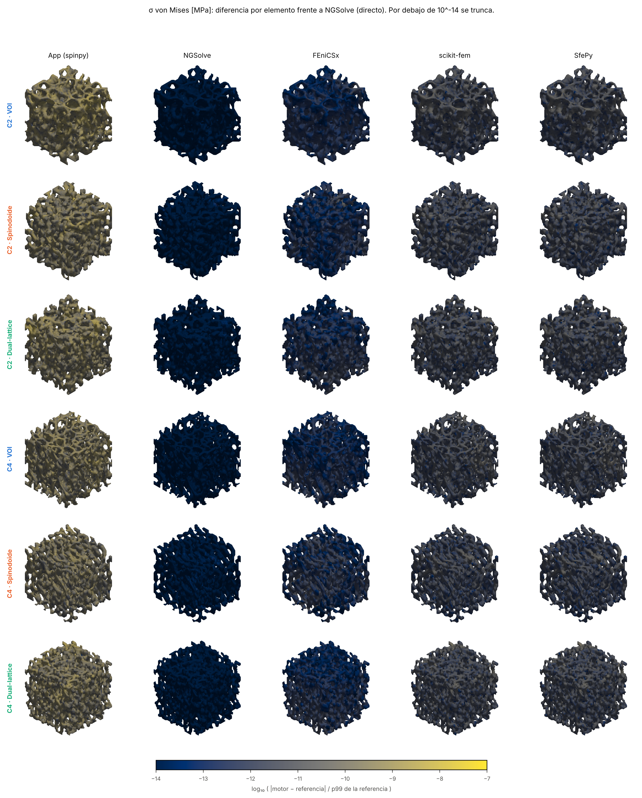
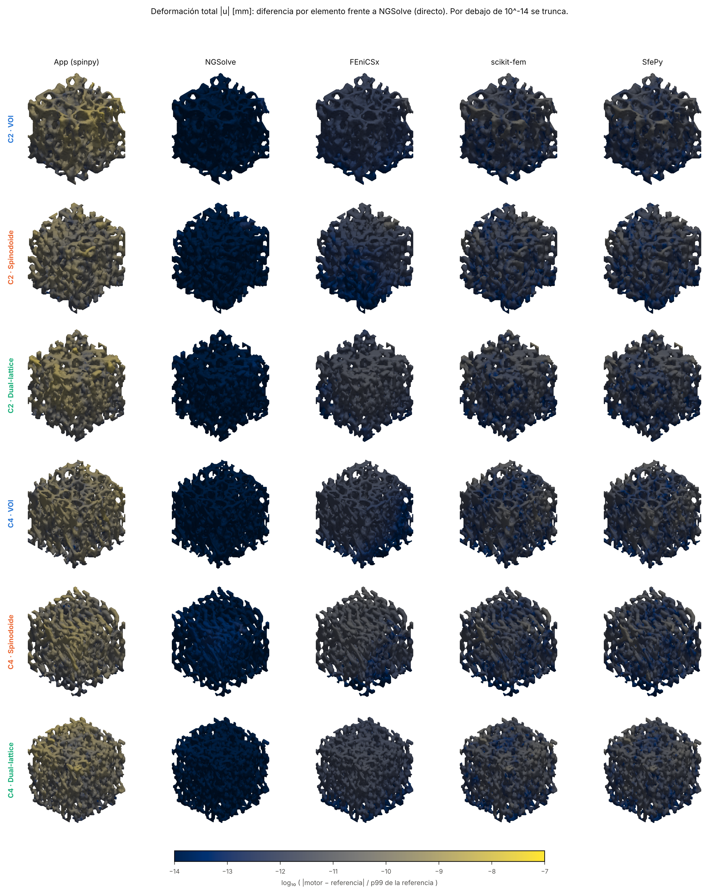
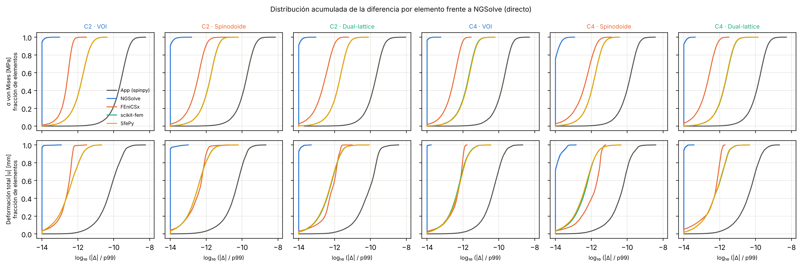

# Protocolo de Tapia et al. (2026) resuelto con cada motor de elementos finitos de spinpy

Fecha: 2026-10-12. spinpy V2.1.1. Código: `comparativa_motores/tapia/` (`ajustar.py`, `replicar_tapia.py`, `figuras_tapia.py`). Datos: `resultados/tapia.jsonl` (una fila por corrida), `campos/*.npz` (campos por elemento y desplazamientos nodales), `estructuras/` (parámetros, error y huella de cada estructura generada). Tablas completas: `tablas_tapia.md`.

## Resumen

**Objetivo.** Aplicar el análisis de compresión del protocolo de Tapia et al. (2026) a muestras porcinas reales y a sus estructuras generadas, resolverlo con cada motor de elementos finitos de spinpy y cuantificar cuánto difieren entre sí los campos de tensión de von Mises y de deformación total.

**Métodos.** Se seleccionaron dos volúmenes de interés (VOI) porcinos de micro-TC, C2 y C4 (188³ vóxeles a 16 µm; BV/TV 0,388 y 0,333), que cubren el rango de los cuatro disponibles. A cada uno se le ajustó un spinodoide y un dual-lattice con el procedimiento del informe automático de la app (modo completo, resolución de comparación de 96³, semilla 20260720). Las seis estructuras (2 VOI, 2 spinodoides, 2 dual-lattices) se mallaron con hexaedros de vóxel a 40³ y se ensayaron con el protocolo de Tapia implementado en `fem.PROTOCOLOS_FEM["tapia2026"]` (base empotrada, E_s = 18 GPa, ν = 0,30, 100 N axiales sobre la sección bruta, material lineal elástico) con la app, NGSolve, FEniCSx, scikit-fem y SfePy. NGSolve con factorización directa se ejecutó además por separado como referencia. Las diferencias se calcularon por elemento como |motor − referencia| dividido por el percentil 99 del campo de referencia en el tejido.

**Resultados.** Los cinco motores dieron el mismo módulo aparente, el mismo p99 y el mismo máximo de von Mises, y el mismo desplazamiento máximo, en las seis estructuras, con las cifras mostradas en las tablas. Elemento a elemento, la mayor diferencia de von Mises frente a la referencia fue de 3,7·10⁻⁹ a 9,1·10⁻⁹ del p99 con la app, de 3,7·10⁻¹¹ a 1,4·10⁻¹⁰ con scikit-fem y SfePy, de 2,8·10⁻¹² a 2,2·10⁻¹¹ con FEniCSx y de 4,3·10⁻¹⁴ a 1,5·10⁻¹³ con NGSolve; en deformación total fueron de magnitud similar. El orden de las diferencias reproduce el orden de las tolerancias de los resolvedores (app 10⁻⁸, scikit-fem y SfePy 10⁻¹⁰, directos 10⁻¹² o menos). Entre estructuras, los dual-lattices tuvieron un módulo aparente un 20 % menor que el de su VOI (C2: 2571 frente a 3220 MPa; C4: 2393 frente a 3018 MPa) y los spinodoides entre un 58 % y un 72 % menor (1361 y 858 MPa).

**Conclusión.** Con una malla común y resolvedores convergidos, la elección del motor no modifica los mapas de tensión ni de desplazamiento del protocolo de Tapia a ningún nivel visible, y las diferencias numéricas son del orden de la tolerancia de cada resolvedor. La variación entre estructuras es de varios órdenes de magnitud mayor que la variación entre motores.

## 1. Alcance y diferencias con el estudio original

Lo que se replica es el **protocolo de ensayo** (condiciones de contorno, carga y constantes del material) y el tipo de salida (von Mises y deformación total), no el estudio original. Tapia et al. analizaron vértebras de dos cérvidos sudamericanos, y el mallado original fue de tetraedros SOLID187 de 0,05 mm en ANSYS (`fem.PROTOCOLOS_FEM`, campo `tam_elem_mm`). Aquí las muestras son VOI porcinos y las mallas son hexaedros de un vóxel a 40³ (lado de 3,008 mm, 0,075 mm por elemento), la resolución por omisión de la app. Por tanto, los valores absolutos de tensión y rigidez de este informe no son comparables con los publicados por Tapia et al.; sí lo son entre motores, que es lo que se midió.

La elasticidad es lineal, sin plasticidad ni daño. En el protocolo, 100 N sobre 9,05 mm² equivalen a 11,05 MPa de tensión aparente, y en el spinodoide de C4 el máximo de von Mises llegó a 483 MPa (874 MPa en el de C2); el comportamiento no lineal a esa carga no se evaluó aquí.

## 2. Métodos

### 2.1 Muestras

| VOI | Forma | Vóxel (µm) | BV/TV |
|---|---|---:|---:|
| C2 | 188³ | 16 | 0,388 |
| C4 | 188³ | 16 | 0,333 |

C2 y C4 son el más denso y el menos denso de los cuatro VOIs recibidos (C1 a C4; BV/TV 0,365, 0,388, 0,335 y 0,333 respectivamente), de modo que cubren el rango disponible. C1 y C3 no se analizaron.

### 2.2 Estructuras generadas

Se ajustaron con `ajustar_spinodoide` y `ajustar_dual_lattice` (modo completo, sin término mecánico ni réplicas de incertidumbre, resolución de comparación de 96³, semilla 20260720) y se regeneraron desde sus parámetros con la misma traducción que usa la app (`informe._regenerar`). Cada máscara se guardó con su huella SHA-256.

| VOI | Familia | Error del ajuste | BV/TV generado | BV/TV del VOI | Parámetros principales |
|---|---|---:|---:|---:|---|
| C2 | Spinodoide | 0,00175 | 0,386 | 0,388 | número de onda 15π, 700 ondas, θ = (45°, 60°, 15°) |
| C2 | Dual-lattice | 0,00057 | 0,388 | 0,388 | 4,24 celdas, estiramiento (1,0, 2,0, 1,0) |
| C4 | Spinodoide | 0,00148 | 0,324 | 0,333 | número de onda 18π, 700 ondas, θ = (15°, 45°, 15°) |
| C4 | Dual-lattice | 0,00064 | 0,333 | 0,333 | 5,0 celdas, estiramiento (1,5, 1,0, 2,5) |

Cada familia se ajustó una sola vez por VOI y no se evaluó la incertidumbre del ajuste.

### 2.3 Ensayo

Se remuestreó cada máscara a 40³ por vecino más próximo, como hace la app, se mallaron los hexaedros con `fem.mallar` (de 20 559 a 24 790 elementos y de 134 322 a 142 176 GDL según la estructura) y se aplicó el protocolo de Tapia. Cada motor resolvió el mismo problema discreto en un proceso hijo con su resolvedor automático, que es lo que obtiene el usuario en la app:

| Motor | Versión | Resolvedor automático a este tamaño |
|---|---|---|
| App (spinpy) | 2.1.1 | CG con multigrid algebraico (pyamg), tolerancia ≈ 10⁻⁸ |
| NGSolve | 6.2.2608 | Cholesky propio (sparsecholesky) |
| FEniCSx | 0.11.0 | Cholesky de MUMPS (PETSc) |
| scikit-fem | 12.0.2 | CG + multigrid algebraico (pyamg), tolerancia 10⁻¹⁰ |
| SfePy | 2026.3 | CG + pyamg, tolerancia 10⁻¹⁰ |

La referencia es NGSolve con el resolvedor directo. **NGSolve con resolvedor automático y la referencia usan el mismo algoritmo** (en este tamaño el automático elige el mismo Cholesky), de modo que su diferencia mide solo el redondeo y la repetibilidad, no una discrepancia entre motores independientes. Las diferencias de los otros cuatro motores sí lo son.

### 2.4 Campos comparados

- **Tensión de von Mises por elemento** (MPa), a partir de la tensión media del elemento (`fem.tension_elemental`, convención de la app para hexaedros).
- **Deformación total por elemento** (mm): módulo del desplazamiento |u| promediado en los 8 nodos de cada elemento, la variable `campo_desp` de la app.
- **Diferencia relativa**: |motor − referencia| / p99 de la referencia, por elemento; en los mapas se muestra su logaritmo decimal, truncado por debajo de 10⁻¹⁴.

## 3. Resultados

### 3.1 Respuesta mecánica por estructura

Valores idénticos en los cinco motores (referencia de NGSolve).

| VOI | Estructura | E_app (MPa) | p99 von Mises (MPa) | Máx. von Mises (MPa) | ‖u‖ máx. (mm) |
|---|---|---:|---:|---:|---:|
| C2 | VOI | 3219,6 | 91,2 | 203,1 | 0,0272 |
| C2 | Spinodoide | 1361,4 | 162,6 | 874,7 | 0,1214 |
| C2 | Dual-lattice | 2571,0 | 109,1 | 509,9 | 0,1453 |
| C4 | VOI | 3017,6 | 94,6 | 275,4 | 0,0408 |
| C4 | Spinodoide | 857,6 | 231,9 | 482,9 | 0,1260 |
| C4 | Dual-lattice | 2392,6 | 117,3 | 270,8 | 0,0323 |

Respecto de su VOI, el dual-lattice tuvo un módulo aparente un 20 % menor en C2 y un 21 % menor en C4, y un p99 de von Mises un 20 % y un 24 % mayor. El spinodoide tuvo un módulo un 58 % menor en C2 y un 72 % menor en C4, y un p99 un 78 % y un 145 % mayor. Estas comparaciones corresponden a un único ajuste por VOI y a una única semilla, y no permiten generalizar el comportamiento de cada familia.

### 3.2 Mapas por motor


A simple vista, los cinco mapas de cada fila son indistinguibles, tanto en von Mises como en deformación total. En las seis estructuras, la concentración de tensión y de desplazamiento se sitúa en las trabéculas de la mitad superior del cubo, que es donde se aplica la carga con base empotrada, y el desplazamiento decrece hacia la base. La escala de color es una por fila (percentiles 1 a 99 de la referencia).

### 3.3 Diferencias entre motores





Los mapas de diferencia están en escala logarítmica entre 10⁻¹⁴ y 10⁻⁷ del p99. No muestran estructura espacial coherente en ningún motor: el patrón es de ruido de redondeo distribuido por todo el tejido, con un nivel de color uniforme por motor. La app es la que más difiere (del orden de 10⁻¹⁰ del p99 en la mediana de los elementos), seguida de scikit-fem y SfePy, que son prácticamente idénticos entre sí, FEniCSx y NGSolve.


Máxima diferencia por elemento en las seis estructuras (rango entre estructuras), como fracción del p99 de la referencia:

| Motor | Von Mises: máxima | Von Mises: mediana | Deformación total: máxima | Deformación total: mediana |
|---|---:|---:|---:|---:|
| App | 3,7·10⁻⁹ a 9,1·10⁻⁹ | 1,3·10⁻¹⁰ a 2,5·10⁻¹⁰ | 2,1·10⁻⁹ a 5,8·10⁻⁹ | 4,5·10⁻¹¹ a 8,6·10⁻¹¹ |
| NGSolve (automático) | 4,3·10⁻¹⁴ a 1,5·10⁻¹³ | 2,2·10⁻¹⁵ a 5,0·10⁻¹⁵ | 1,7·10⁻¹⁴ a 1,4·10⁻¹³ | 9,6·10⁻¹⁶ a 5,7·10⁻¹⁵ |
| FEniCSx | 2,8·10⁻¹² a 2,2·10⁻¹¹ | 2,1·10⁻¹³ a 4,9·10⁻¹³ | 1,7·10⁻¹² a 1,8·10⁻¹¹ | 2,8·10⁻¹³ a 1,6·10⁻¹² |
| scikit-fem | 3,7·10⁻¹¹ a 1,4·10⁻¹⁰ | 1,3·10⁻¹² a 2,1·10⁻¹² | 2,1·10⁻¹¹ a 8,3·10⁻¹¹ | 3,2·10⁻¹³ a 7,4·10⁻¹³ |
| SfePy | 3,7·10⁻¹¹ a 1,3·10⁻¹⁰ | 1,4·10⁻¹² a 2,1·10⁻¹² | 2,1·10⁻¹¹ a 8,5·10⁻¹¹ | 3,2·10⁻¹³ a 7,1·10⁻¹³ |



Las curvas acumuladas muestran que estas diferencias se distribuyen de forma muy estrecha (unas 2 décadas de ancho) y que el orden entre motores es el mismo en las seis estructuras y en ambos campos, salvo en la deformación total, donde FEniCSx, scikit-fem y SfePy quedan casi superpuestos. Dado que estos tres tienen tolerancias o factorizaciones distintas, esa coincidencia en |u| no se atribuye a ninguna causa concreta.

La ordenación de las diferencias coincide con la de las tolerancias de los resolvedores: app (residuo relativo de 8,8·10⁻⁹ en C2), scikit-fem (5,6·10⁻¹¹), y los directos de NGSolve y FEniCSx (5,8·10⁻¹³ y 1,8·10⁻¹³). Esto sugiere que la diferencia entre motores está dominada por la precisión del resolvedor y no por el montaje o la cuadratura, aunque este estudio no aísla ambos efectos (para ello habría que resolver todos los motores con la misma tolerancia).

### 3.4 Tiempo por motor

Tiempo total del motor para cada estructura (40³, unos 135 000 a 142 000 GDL), mediana y rango en las seis estructuras, con una sola corrida cada una:

| Motor | Mediana (s) | Rango (s) |
|---|---:|---:|
| NGSolve (Cholesky) | 3,4 | 2,1 a 6,9 |
| FEniCSx (MUMPS) | 3,6 | 3,1 a 5,4 |
| App | 10,5 | 8,6 a 12,7 |
| SfePy (CG + pyamg) | 12,2 | 10,3 a 15,8 |
| scikit-fem (CG + pyamg) | 27,0 | 22,1 a 29,3 |

Estos tiempos son coherentes con los del informe de tiempos (`tiempos_sesion/INFORME_TIEMPOS.md`) pero no lo sustituyen: aquí se midió una corrida por estructura.

## 4. Discusión

La concordancia entre motores es del orden esperable de un problema lineal bien condicionado resuelto sobre un problema discreto idéntico. El resultado no depende de las estructuras elegidas: las seis, con rigideces que difieren en un factor 4 y máximos de von Mises que difieren en un factor 4, dieron diferencias entre motores del mismo orden. Por tanto, para este protocolo, la elección del motor puede hacerse por criterios de tiempo, memoria y distribución, que es lo que recomienda el informe de motores, y no por diferencias en los campos resultantes.

Conviene distinguir qué se ha comprobado. Se ha comprobado que cinco implementaciones independientes de elementos hexaédricos lineales dan el mismo campo sobre la misma malla. No se ha comprobado que esa malla (40³) sea suficiente: el error de discretización del hexaedro de un vóxel respecto de la solución del continuo no se evaluó aquí, y el informe de motores indica que el error L2 baja con el cuadrado del tamaño de elemento. Por la misma razón, no se ha comparado con el estudio de Tapia et al., que usó tetraedros de 0,05 mm.

La diferencia de rigidez entre cada VOI y sus estructuras generadas (módulo un 20 % menor en los dual-lattices y de un 58 % a un 72 % menor en los spinodoides) es un resultado de este ajuste concreto, con semilla única y sin término mecánico en el objetivo, y no una propiedad general de las familias. Con el mismo BV/TV, la rigidez depende de la orientación y la conectividad, que el ajuste morfométrico no fuerza.

## 5. Limitaciones

- Dos VOI de cuatro, un ajuste y una semilla por VOI y familia: no se estimó la variabilidad entre semillas ni entre muestras.
- Malla de hexaedros de un vóxel a 40³ para todos los motores; no se evaluaron TET10 ni la convergencia de malla en este protocolo.
- Elasticidad lineal; no se evaluó el comportamiento no lineal a 100 N.
- Las diferencias entre motores están dominadas por la tolerancia de cada resolvedor y no se igualaron las tolerancias, por lo que no se puede atribuir la diferencia restante al montaje o a la cuadratura de cada biblioteca.
- La referencia (NGSolve directo) es una de las cinco soluciones; la diferencia de NGSolve automático frente a ella no es independiente.
- Una corrida por combinación en los tiempos. Durante la ejecución de FEniCSx se usó el Python de su entorno de conda; el resto, el del entorno principal.
- No es un estudio observacional ni clínico: no existe una guía de reporte (STROBE, CONSORT, PRISMA, etc.) aplicable, por lo que no se incluye lista de chequeo. La referencia del protocolo es Tapia D, González A, Vidal F, Salinas P. A specimen-based comparative micro-CT-FEA analysis of vertebral trabecular bone microarchitecture and mechanical response in two South American cervids. *Biology*. 2026;15:722, tal como figura en `Test/README.md` del repositorio; no se verificó en una base bibliográfica externa durante esta sesión.

## 6. Reproducir

```
cd comparativa_motores/tapia
# VOIs: colocar VOI_C2.mat y VOI_C4.mat en vois/
python ajustar.py C2 C4
python replicar_tapia.py C2 C4 --motores app ngsolve skfem sfepy referencia
$FENICSX_PYTHON replicar_tapia.py C2 C4 --motores fenicsx
xvfb-run -a python figuras_tapia.py
```
